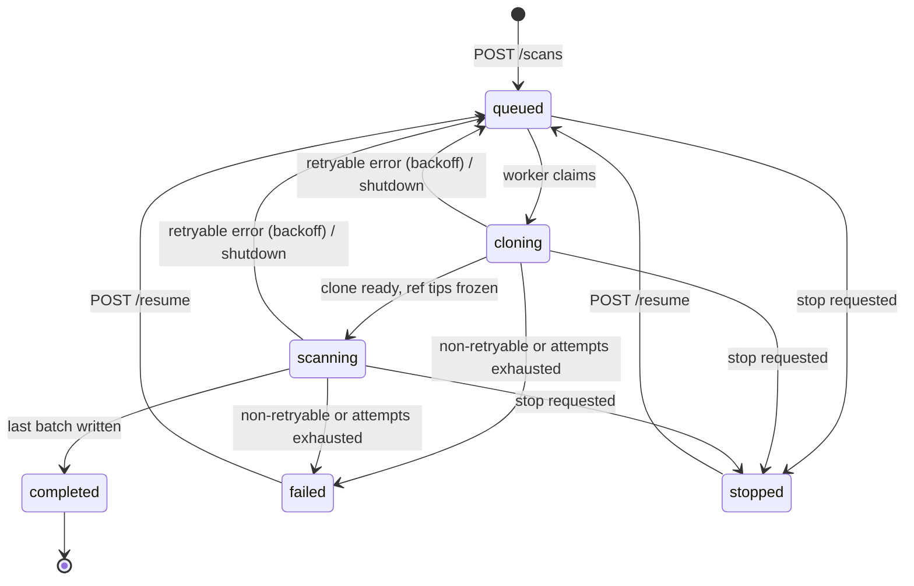

# Architecture — AWS Secret Scanner

## What it does
A web service that takes a GitHub repo, clones it, and scans every commit reachable from any ref (branches, tags, pull
requests), newest commit first, for leaked AWS credentials. Each finding records the commit, its committer and the
leaked value. Scans are jobs in a database queue. Workers claim them, write progress as checkpoints, and resume from the
last checkpoint after a crash, a restart or a stop. The API and the workers can run in separate containers.

The requirements are in [`ASSIGNMENT.md`](ASSIGNMENT.md).

| Requirement | How it is met |
|---|---|
| Descending by commit time, every file diff | We sort all commits by committer time ourselves, then feed them to `git log -p` in that order |
| Continue from the placeholder after an interruption | A checkpoint (position in a frozen, sorted commit list) written in the same transaction as the findings |
| Commit info, committer, leak value | Stored on each finding, returned by the API |
| Non-main branches | Mirror clone: every branch, tag and PR ref; each commit scanned once |
| Web server with an API | Fastify REST API |
| Containerize | One image, two roles (`api`, `worker`); compose runs 1 api + 2 workers |
| Delete the clone at the end | A clone directory exists only while a worker holds the scan |

## Components

```
HTTP ─► api/ (routes) ─► services/scanService ─► db/ (repositories) ◄─ worker/workerPool ─► scanner/scanRunner
                                                                                             ├─► git/ (clone, list, log stream)
                                                                                             └─► scanner/detector
```

| Component | Owns | Files |
|---|---|---|
| Config | Env vars parsed and validated once with Zod | `src/config.ts` |
| Logger | The pino instance, created in the entry point and passed in | `src/logger.ts` |
| Domain schemas | `Scan`, `Finding`, `ScanStatus`, API request/response shapes, repo URL parsing | `src/domain/*.ts` |
| Database | Opens SQLite (`node:sqlite`), WAL mode, busy timeout, schema creation | `src/db/database.ts` |
| Scan repository | All scan SQL: create, claim, renew lease, transition, checkpoint | `src/db/scanRepository.ts` |
| Finding repository | Insert findings (idempotent), page through them | `src/db/findingRepository.ts` |
| State machine | The allowed transitions table and the check | `src/domain/scanStateMachine.ts` |
| Git client | Runs `git` as a child process: mirror clone, list commits, stream `log -p`. Token goes in a header, never in the URL | `src/git/gitClient.ts` |
| Commit lister | Lists commits reachable from the frozen ref tips and sorts them by committer time | `src/git/commitLister.ts` |
| Diff parser | Turns the `git log -p` text stream into commits and their added lines (file, line number) | `src/git/diffParser.ts` |
| Detector | AWS key patterns run over one line | `src/scanner/detector.ts` |
| Scan runner | Runs one claimed scan from its checkpoint to the end, batch by batch | `src/scanner/scanRunner.ts` |
| Worker pool | N slots per process: claim, heartbeat, run, retry/backoff, graceful shutdown | `src/worker/workerPool.ts` |
| Scan service | API business logic: create (dedupe), get, list, stop, resume | `src/services/scanService.ts` |
| API | Fastify routes, validation, error mapping | `src/api/*.ts` |
| Entry point | Builds everything; starts the api, the workers or both depending on `ROLE` | `src/index.ts` |

## Data model (SQLite)

**scans**

| Column | Meaning |
|---|---|
| `id` | UUID |
| `repoUrl` | Normalized `https://github.com/owner/repo` |
| `status` | `queued` · `cloning` · `scanning` · `completed` · `failed` · `stopped` |
| `refTips` | JSON map ref → commit SHA, frozen on first clone. Defines exactly which commits this scan covers |
| `totalCommits` | Size of the sorted commit list |
| `scannedCommits` | The checkpoint: how many commits from the top of the sorted list are fully scanned |
| `lastScannedSha` | SHA at the checkpoint, used to confirm the list is identical on resume |
| `attempt` | Claims so far; capped by `MAX_ATTEMPTS` |
| `leaseOwner`, `leaseExpiresAt` | Which worker holds it and until when |
| `leaseToken` | Fencing token, incremented on every claim. Every worker write includes it |
| `stopRequested` | Set by the API; the worker obeys it between batches |
| `runAfter` | Earliest time it may be claimed again (retry backoff) |
| `error` | Last failure message |
| `createdAt`, `updatedAt`, `finishedAt` | Timestamps |

A unique partial index on `repoUrl WHERE status IN ('queued','cloning','scanning')` means one active scan per repo,
even when two requests race.

**findings**

| Column | Meaning |
|---|---|
| `id` | Auto-increment; also the pagination cursor (insert order = scan order) |
| `scanId` | Owning scan |
| `commitSha`, `commitMessage`, `committedAt` | Commit info |
| `committerName`, `committerEmail`, `authorName`, `authorEmail` | Who |
| `filePath`, `lineNumber` | Where (line number in the new file) |
| `leakType` | `aws_access_key_id` or `aws_secret_access_key` |
| `leakValue` | The full value (the assignment asks for it) |

Unique on `(scanId, commitSha, filePath, lineNumber, leakValue)` with `INSERT OR IGNORE`, so replaying a batch after a
crash never duplicates findings.

## Scan state machine



- Every status change goes through `transition(scanId, from, to, leaseToken)`. It checks the table above, then runs
  `UPDATE … WHERE id = ? AND status = ? AND leaseToken = ?`. Zero rows updated means someone else changed the scan first.
  The caller gets a "lost" result and stops; nothing is overwritten.
- A worker crash leaves a scan in `cloning`/`scanning` with an expired lease. The claim query picks those up as well, so
  no extra state is needed for "orphaned".

## Flows

### Happy path
1. `POST /scans {repoUrl}`: validate and normalize the URL. Insert a `queued` scan. If the unique index rejects it, return
   the active scan for that repo (200) instead of 202.
2. A worker slot claims: in one transaction it selects the oldest claimable scan (`queued` and `runAfter <= now`, or
   `cloning`/`scanning` with an expired lease), sets status `cloning`, its lease, `leaseToken + 1`, `attempt + 1`.
3. Heartbeat: every `LEASE_MS / 3` the slot renews the lease (fenced by `leaseToken`) and reads `stopRequested`.
4. Clone: `git clone --mirror --filter=blob:none` into `DATA_DIR/clones/<scanId>` (history and trees only; file
   contents are fetched by git page by page when step 6 diffs them). On the first run, read all ref tips and save them as
   `refTips`. On a resume, check every frozen tip still exists in the clone.
5. `cloning → scanning`. List commits reachable from `refTips` with committer time, sort by time desc, then SHA. Check
   that the commit at `scannedCommits` matches `lastScannedSha`.
6. For each batch of `BATCH_SIZE` commits after the checkpoint: stream
   `git log -p --no-walk=unsorted --stdin --no-renames --format=…` with those SHAs, parse, run the detector on added
   lines, then in **one transaction** insert findings and advance `scannedCommits`/`lastScannedSha` (fenced).
7. `scanning → completed`, delete the clone directory.
8. `GET /scans/:id` shows progress (`scannedCommits / totalCommits`); `GET /scans/:id/findings?cursor=&limit=` pages
   findings.

### Failure paths
| What fails | What happens |
|---|---|
| Invalid `repoUrl` | 400, nothing stored |
| Repo not found / bad token (git stderr) | Non-retryable: `failed` with the error, clone dir deleted |
| Network error, timeout during clone | Retryable: back to `queued` with `runAfter = now + base * 2^attempt`; `failed` after `MAX_ATTEMPTS` |
| Worker process crashes mid-batch | The batch transaction never committed. The lease expires, another slot claims it, re-clones, resumes at the checkpoint. Any partial work is redone; the unique key stops duplicates |
| Worker is slow, its lease expires, another worker takes over | The old worker's next fenced write updates 0 rows → it aborts and kills its git process. Only the new holder can write |
| Heartbeat can't renew | Same as above: the slot aborts the run |
| History rewritten between crash and resume (frozen tip SHA gone) | `failed` with "history changed, start a new scan". We never scan a different list under the same checkpoint |
| `POST /stop` | `queued` → `stopped` immediately. A running scan: the heartbeat sees the flag, the runner stops after the current batch, `stopped`, clone deleted |
| `POST /resume` on `stopped`/`failed` | → `queued` with `attempt = 0`; continues from its checkpoint |
| Invalid transition (stop a completed scan, resume a running one) | 409 |
| SIGTERM | Stop claiming, abort runners, release their scans to `queued` without counting an attempt, delete clones, close the DB |
| Leftover clone dirs after a crash | Each worker wipes its own clone root at start |

### Concurrency rules
- **Claiming** is one SQLite write transaction (`BEGIN IMMEDIATE`), so two slots can never claim the same scan. With
  Postgres this becomes `SELECT … FOR UPDATE SKIP LOCKED`.
- **Fencing token** on every worker write: a worker that lost its lease can't write anything.
- **One active scan per repo** is enforced by the unique partial index, not by a read-then-write check.
- **Idempotent writes**: findings unique key + checkpoint in the same transaction = exactly-once results.
- **Isolation on disk**: one clone directory per scan, owned by the slot that holds the lease.
- A scan is processed in order (required); throughput comes from many scans at once (`WORKER_CONCURRENCY` slots per
  worker × worker containers).

## Scale

| Dimension | Approach |
|---|---|
| Many commits (1M+) | Commit list = SHA + timestamp, about 100 MB for 1M commits in memory. Diffs are streamed line by line, so memory doesn't grow with history. Checkpoints every batch bound the work lost to a crash. Beyond ~10M commits: sort with `git log --format='%ct %H' \| sort` on disk instead of in memory |
| Many branches / PRs | One mirror clone fetches all refs at once; we scan commits, not branches, so a commit on 500 branches is scanned once |
| Large files and diffs | Streamed; binary files skipped by git. `core.bigFileThreshold` (config, default 50 MB) makes git treat bigger blobs as binary. `--no-renames` avoids rename detection, which is slow on huge commits |
| Huge clone on disk | Blobless bare mirror: file contents arrive only as each page of commits is diffed. Deleted as soon as the worker lets go of the scan |
| Many repos in a tenant | Each repo is a queued scan; add worker containers to scale out. Multi-host needs Postgres instead of SQLite; only the repositories change |
| One giant repo | Designed, not built: split the sorted list into ranges (shards), each its own job with its own checkpoint, merged by `committedAt` in the API |
| Many findings | Keyset pagination on `findings.id` |
| GitHub rate limits | Not an issue with clone: one fetch per scan attempt instead of one API call per commit |

### Paging (where it happens and the trade-off)
| Layer | How we page | Trade-off chosen |
|---|---|---|
| Getting history from GitHub | Blobless mirror clone: commits + trees up front, blobs fetched lazily per page of commits | Fast first finding and disk grows with progress, at the cost of needing the network during the whole scan (covered by retries + checkpoint). Rejected: full clone (slow start, full disk up front) and the REST API (~5,000 commits/hour, max 3,000 files per commit, patches dropped for large diffs, k-way merge across branches) |
| Processing | Pages of `BATCH_SIZE` commits from the sorted list; each page = one transaction with its checkpoint | Bigger pages: fewer writes, more redo after a crash. Default 200 |
| Sorted commit list | Held in memory (~100 MB per 1M commits) | Past ~10M commits: sort on disk, or page by time windows with checkpoint (window, index) |
| Results | Keyset cursor on `findings.id` | Offset paging slows down with depth and skips/repeats rows while a scan is still writing |

## Deployment
- One Docker image (`node:24-alpine` + `git`). `ROLE=api`, `ROLE=worker` or `ROLE=all` (default, for local dev).
- `docker-compose.yml`: `api` (port 3000) + `worker` with `replicas: 2`, sharing a named volume for the SQLite file.
  Each worker's clone directory is local to its container.
- SQLite in WAL mode works for several processes on one host. Several hosts need Postgres.
- `GITHUB_TOKEN` is optional (public repos work without it) and is passed only to workers.

## Config (env)
`ROLE`, `PORT`, `DATA_DIR`, `GITHUB_TOKEN`, `WORKER_CONCURRENCY` (3), `LEASE_MS` (30000), `POLL_MS` (1000),
`BATCH_SIZE` (200), `MAX_ATTEMPTS` (3), `RETRY_BASE_MS` (5000), `CLONE_TIMEOUT_MS` (600000), `BIG_FILE_THRESHOLD` (50m).

## Detection
- Access key ID: `\b(AKIA|ASIA|ABIA|ACCA)[A-Z0-9]{16}\b`.
- Secret access key: a 40-character `[A-Za-z0-9/+=]{40}` value on a line that also has a keyword like `aws_secret`,
  `secret_access_key`, `aws_secret_access_key` (case-insensitive).
- Only added lines in non-merge commits. Every removed line was added by an earlier commit we also scan.

## API

| Method & path | Result |
|---|---|
| `POST /scans` `{repoUrl}` | 202 `{scanId}` new · 200 existing active scan · 400 invalid |
| `GET /scans` | List of scans (newest first) |
| `GET /scans/:scanId` | Status, progress, error, timestamps · 404 |
| `GET /scans/:scanId/findings?cursor=&limit=` | `{findings, nextCursor}` |
| `POST /scans/:scanId/stop` | 202 · 409 if already finished |
| `POST /scans/:scanId/resume` | 202 · 409 if not `stopped`/`failed` |
| `GET /health` | 200 |

## Out of scope (deliberately)
- Scanning merge diffs (`--cc`). Evil merges that add content only in the merge are missed.
- Verifying keys against AWS, entropy scoring, other secret types.
- Git LFS content (only the pointer files are scanned).
- Incremental rescans (only commits new since the last completed scan). The frozen `refTips` would make this easy.
- Sharding one repo across workers. Designed above, not built.
- Auth on our own API.
- Concurrency tests (the design covers it; the assignment doesn't expect tests).

## Plan

**Workers:** me (orchestrator), Claude implementers, one Codex reviewer, one Claude worker building the fixture repo.
T1 lands alone first; everything after it builds on its schemas and data model. Then two implementers work in
parallel on separate files.

| Task | Content | Who | Depends on |
|---|---|---|---|
| T1 Foundation | Config, logger, domain schemas, state machine, database + tables, both repositories, and the git module's types and function signatures (contracts only) | Implementer A | — |
| T2 Git + detection | Git client, commit lister, diff parser, detector, their unit tests | Implementer B | T1 |
| T3 Scanning | Scan runner, worker pool (claim, heartbeat, fencing, retry, shutdown). Codes against the git contracts T1 defines, in parallel with T2 | Implementer A | T1 |
| T4 API | Scan service, Fastify routes, entry point with roles | Implementer B | T1 |
| T5 Ship | Dockerfile, compose, README, end-to-end run against the fixture repo | Me + Implementer B | T3, T4 |

**Timeline (today):** T1 by 14:55 · then A: T3, B: T2 → T4 · all by 15:40 · T5 by 15:50 · README done 15:55 ·
interview ~16:10. You review each task's diff before it is committed. Codex reviews after T3/T4.

**If we run late, cut in this order:** stop/resume endpoints → Codex review → compose with 2 workers (keep one container).

## Decision log
| Decision | Why | Alternative |
|---|---|---|
| Git clone, not GitHub API | One fetch for the whole history; no per-commit rate limit; no truncated diffs | API: one request per commit diff, days for a large repo |
| Blobless clone (`--filter=blob:none`) | Pages the download: fast first finding, disk grows with progress | Full clone: everything up front |
| Mirror clone, `--all` refs incl. PRs | Assignment: as inclusive as possible | Branches only |
| Sort commits ourselves by committer time | Git's default order isn't strict under clock skew | Trust `git log` order |
| Freeze ref tips at first clone | Resume sees the exact same commit list, so a position is a valid placeholder | Re-read refs on resume (list shifts when people push) |
| Checkpoint + findings in one transaction, unique key on findings | Exactly-once results across crashes | Checkpoint separately (duplicates or gaps) |
| DB-backed queue with leases + fencing token | Survives crashes; safe with many workers | In-memory queue (lost on crash) |
| Explicit state machine with compare-and-set transitions | Every status change is checked and race-safe | Free-form status updates |
| SQLite via `node:sqlite` | No extra service or package; transactions | Postgres (needed for multi-host; documented) |
| Same image, `api`/`worker` roles | API and workers scale separately | One process doing both |
| Parallelism across scans, not inside one | Order is a requirement; branches share commits | Split by branch (rescans shared commits) |
| Added lines only, skip merges | No double reports | Scan removed lines / `--cc` |
| Clone dir lives only while a worker holds the lease | Simple cleanup rule; no shared disk between workers | Keep clones to reuse on resume |
| Fastify | Schema validation, simple shutdown hooks | Express 5 |
