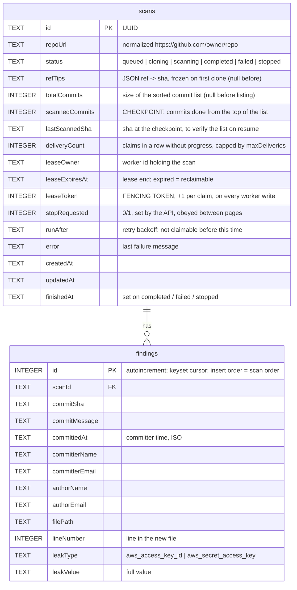

# Data model (ERD)

Source of truth: `src/db/schema.ts` (SQL) and `src/domain/scan.ts`, `src/domain/finding.ts` (Zod).

## Indexes and what each one protects

| Index | Columns | Purpose |
|---|---|---|
| `scans_one_active_per_repo` (unique, partial) | `repoUrl` where status in `queued, cloning, scanning` | At most one active scan per repo, even when two `POST /scans` race |
| `scans_status_run_after` | `status, runAfter` | Fast claim query |
| `findings_unique_leak` (unique) | `scanId, commitSha, filePath, lineNumber, leakValue` | A page replayed after a crash can't duplicate findings (`INSERT OR IGNORE`) |
| primary key | `findings.id` | Keyset pagination: `WHERE scanId = ? AND id > ? ORDER BY id LIMIT ?` |

## Column groups in `scans`

| Group | Columns | Written by |
|---|---|---|
| Identity | `id`, `repoUrl`, `createdAt` | API on create |
| State machine | `status`, `error`, `finishedAt`, `updatedAt` | `transitionScan` (compare-and-set) |
| Resume placeholder | `refTips`, `totalCommits`, `scannedCommits`, `lastScannedSha` | Worker, fenced by `leaseToken` |
| Queue / lease | `deliveryCount`, `leaseOwner`, `leaseExpiresAt`, `leaseToken`, `runAfter` | `claimNextScan`, `renewLease` (`advanceCheckpoint` resets `deliveryCount`) |
| Control | `stopRequested` | API (`requestStop`), read by the heartbeat |

## Choices to review

1. **Two tables, findings denormalized.** Commit info (sha, message, committer, author, time) is copied onto every
   finding instead of a separate `commits` table. Findings are rare (a few per repo), so the repetition is tiny, and
   one row = one complete answer for the API with no join. A `commits` table would hold one row per scanned commit
   (millions) just to serve a few findings.
2. **No `repos` table.** A repo is identified by its normalized URL on the scan. A `repos` table would be useful for
   incremental rescans (store the last completed scan's ref tips per repo); listed as an extension. Full reasoning: `DESIGN_DECISIONS.md` section 19.
3. **Queue state lives on the scan row**, not a separate `jobs` table. One scan = one job, so a second table would
   only add a join. With sharding (one scan → many range jobs), a `scanShards` table would hold the per-range
   checkpoint and lease columns.
4. **Timestamps as ISO text.** SQLite has no date type; ISO strings sort correctly as text.
5. **`refTips` as JSON text.** It's written once and only read back whole, so it doesn't need its own table.
